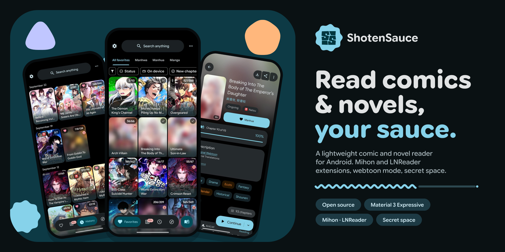
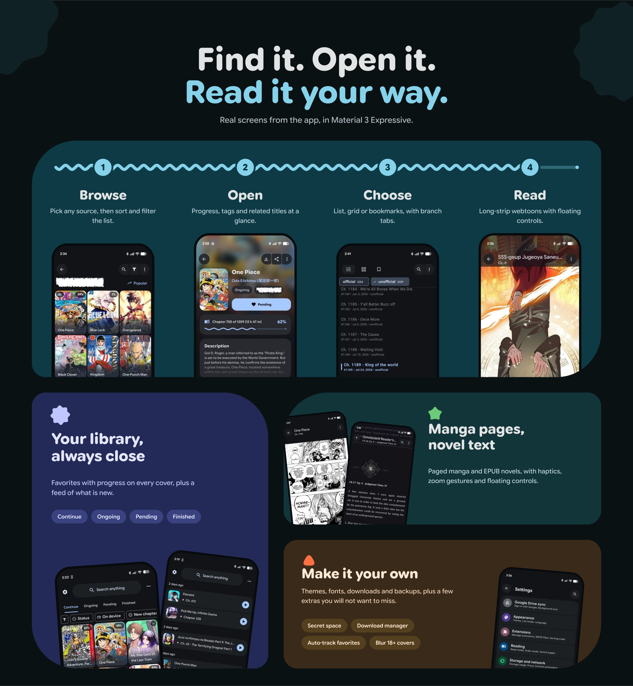

<h1 align="center">ShotenSauce</h1>

<p align="center">
  
</p>

<p align="center">
  A fast, modern manga and novel reader for Android, built with Material 3 Expressive.<br>
  Works with Mihon and LNReader extensions.
</p>

<p align="center">
  <a href="https://github.com/RoTatsuLabs/ShotenSauce/releases/latest"></a>
  <a href="https://github.com/RoTatsuLabs/ShotenSauce/releases"></a>
  <a href="LICENSE"></a>
</p>

<p align="center">
  <a href="https://developer.android.com/"></a>
  <a href="https://kotlinlang.org/"></a>
  <a href="https://developer.android.com/compose"></a>
  <a href="https://m3.material.io/"></a>
</p>

<p align="center">
  <a href="https://github.com/RoTatsuLabs/ShotenSauce/releases/latest"><strong>Download</strong></a>
  &nbsp;·&nbsp;
  <a href="CHANGELOG.md"><strong>Changelog</strong></a>
  &nbsp;·&nbsp;
  <a href="https://github.com/HuzaifaKhalid1311/DropSauce"><strong>Upstream</strong></a>
</p>

<p align="center">
  <a href="#about">About</a> ·
  <a href="#features">Features</a> ·
  <a href="#install">Install</a> ·
  <a href="#faq">FAQ</a> ·
  <a href="#project-structure">Structure</a> ·
  <a href="#credits">Credits</a>
</p>

---

## About

ShotenSauce is a free, open-source reader for manga, webtoons and novels on Android. It aims to feel quick and clean while still packing in a lot of features.

It is a personal fork of [DropSauce](https://github.com/HuzaifaKhalid1311/DropSauce), built for my own use and shared as is. It takes no issues or pull requests, and comes with no support, no guarantees and no promise of updates or fixes.

> [!NOTE]
> This app code is mostly written with AI assistance (Claude), directed and reviewed by me. If you are not comfortable with that, this project may not be for you.

## Highlights

<p align="center">
  
</p>

<details>
<summary><strong>Features</strong></summary>

- Manga, webtoon and novel reader with configurable behavior, haptics and zoom gestures.
- Offline EPUB import, and PDF import that turns PDFs into readable CBZ chapters.
- Native sources, LNReader JS plugins, and Mihon and Tsundoku APK extensions.
- Favourites with categories, history, bookmarks with colour labels, reading stats, and a find-duplicates tool.
- Tracking with Shikimori, AniList, MyAnimeList, Kitsu and MangaBaka, with tracker import to fill a title's covers, titles, descriptions and genres field by field.
- Auto-track: favourites are tracked on every tracker you use together with your reading progress. Uncertain matches wait for your review.
- Smart categories: when a title's status changes on a tracker, it moves to the category you bound to that status.
- Downloads with filters, drag to reorder, parallel pages, charging-only mode, smart retries, and download-ahead while you read.
- Local and scheduled backups, Telegram backups with selectable contents, and Kotatsu and Mihon backup restore. Every backup and restore runs with a progress notification and a cancel button.
- Material 3 Expressive details page with colours taken from the cover, custom fonts (`.ttf` or `.otf`), and home screen widgets.
- Secret space (hidden library, history, bookmarks and downloads behind a PIN or fingerprint) and app lock.
- Blurred 18+ titles and genres you pick, everywhere. Hold a cover to peek.
- In-app updates, with APKs also published on GitHub Releases.

</details>

The full list of changes is in the [changelog](CHANGELOG.md).

## Install

1. Open the [latest release](https://github.com/RoTatsuLabs/ShotenSauce/releases/latest).
2. Download the newest `ShotenSauce` APK.
3. Install it on a device running Android 8.0 or newer.
4. Add a source or extension repository, then start reading.

Android may ask you to allow installs from your browser or file manager. That is normal for APKs downloaded outside the Play Store.

## FAQ

<details>
<summary><strong>Does ShotenSauce include manga or novels?</strong></summary>

No. There is no built-in content. Sources come from external libraries, JS plugins or repositories that you add yourself.

</details>

<details>
<summary><strong>Is it free?</strong></summary>

Yes. ShotenSauce is free and open source under the GPLv3 license.

</details>

<details>
<summary><strong>How do updates work?</strong></summary>

Update from inside the app, or install the latest APK from the Releases page.

</details>

<details>
<summary><strong>Can I move over from Kotatsu, DropSauce or Mihon?</strong></summary>

Yes. Restore a Kotatsu or Mihon backup from the Backup screen.

</details>

## Project structure

```plaintext
app/src/main/
├── kotlin/org/koitharu/kotatsu/
│   ├── core/          # Database, network, parser, preferences, UI and utilities
│   ├── main/          # App entry points and main screens
│   ├── reader/        # Manga and novel reader
│   ├── details/       # Title details, chapters and metadata
│   ├── explore/       # Browse and discovery
│   ├── search/        # Search, with a Manga/Novel toggle
│   ├── favourites/    # Favourites, categories and duplicates
│   ├── bookmarks/     # Bookmarks and colour labels
│   ├── history/       # Reading history and progress
│   ├── download/      # Offline downloads and queue
│   ├── extensions/    # Extension browsing, JS plugins, APK extensions
│   ├── lnreader/      # LNReader JS plugin integration
│   ├── mihon/         # Mihon and Tsundoku extension integration
│   ├── backup/        # Backup and restore
│   ├── scrobbling/    # Tracker services, auto-track and smart categories
│   ├── tracker/       # New chapter checks
│   ├── stats/         # Reading statistics
│   ├── secret/        # Secret space
│   ├── widget/        # Home screen widgets
│   └── settings/      # Settings screens
└── res/
    ├── drawable*/     # Icons and backgrounds
    ├── layout*/       # XML layouts
    ├── values*/       # Strings, colors, themes and translations
    └── xml/           # Android XML configuration
```

## Star history

<a href="https://www.star-history.com/?repos=rotatsulabs%2Fshotensauce&type=date&releases=&legend=bottom-right">
 <picture>
   <source media="(prefers-color-scheme: dark)" srcset="https://api.star-history.com/chart?repos=rotatsulabs/shotensauce&type=date&theme=dark&legend=bottom-right" />
   <source media="(prefers-color-scheme: light)" srcset="https://api.star-history.com/chart?repos=rotatsulabs/shotensauce&type=date&legend=bottom-right" />
   
 </picture>
</a>

## Credits

ShotenSauce is a fork of [DropSauce](https://github.com/HuzaifaKhalid1311/DropSauce) by HuzaifaKhalid1311, and exists because of the open-source Android manga reader community. Thanks to the developers of [Kotatsu](https://github.com/KotatsuApp/Kotatsu), [LNReader](https://github.com/LNReader/lnreader) and [Mihon](https://github.com/mihonapp/mihon) for the ideas, code and source ecosystem behind it.

These projects also inspired features. They were written for this app, and their code is not copied from them.

- [Hyoukan](https://github.com/PineappleTwilight/hyoukan): smart categories bound to tracker status, bookmark colours with a colour filter, Find duplicates, and the database integrity check with rolling snapshots
- [AniZen](https://github.com/salmanbappi/AniZen): a sturdier downloader, with no retries on dead links, retry jitter and a free-space check

## License

[](http://www.gnu.org/licenses/gpl-3.0.en.html)

All programs from the ShotenSauce project (a fork of DropSauce) are free, open-source programs under the GPL license. You may copy, distribute and modify the software as long as you keep track of changes and dates in the source files. Any modification of the software, including code licensed under the GPL (via a compiler), must also be provided under the GPL license.

## Disclaimer

The developers of this application have no affiliation with the content providers available through it. Any content comes from external libraries added or imported by users; the application itself includes no built-in content.
